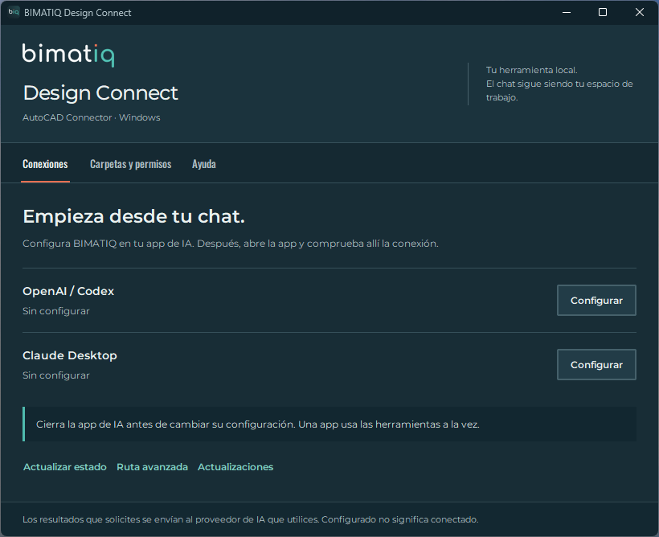

<p align="center">
  
</p>

<h1 align="center">BIMATIQ Design Connect</h1>

<p align="center"><strong>Del chat al dibujo. Con control en cada paso.</strong></p>

<p align="center">Lee, crea y edita en AutoCAD desde OpenAI / Codex local o Claude Desktop.</p>

<p align="center">
  <a href="https://github.com/bimatiq/design-connect-downloads/releases/latest/download/BIMATIQ.DesignConnect-stable-Setup.exe"></a>
</p>

<p align="center">Versión 0.2.5 &nbsp; · &nbsp; Windows x64 &nbsp; · &nbsp; AutoCAD 2026</p>

<p align="center">
  <a href="#empieza-en-3-pasos">Instalación</a> &nbsp; / &nbsp;
  <a href="#qué-puedes-hacer">Funciones</a> &nbsp; / &nbsp;
  <a href="#compatibilidad">Compatibilidad</a> &nbsp; / &nbsp;
  <a href="#ayuda">Ayuda</a>
</p>

---

## Empieza en 3 pasos

### 01 · Instala

Descarga y ejecuta **BIMATIQ.DesignConnect-stable-Setup.exe**. No necesitas una cuenta de GitHub, Python ni .NET SDK. Si ya usas BIMATIQ, cierra todas sus conexiones antes de actualizar.

### 02 · Configura

Abre **BIMATIQ Design Connect** desde Inicio. En **Carpetas y permisos**, autoriza una carpeta de copias de trabajo y guarda los ajustes. Activa **Creación y edición** cuando necesites modificar dibujos; el editor de texto tiene un permiso separado. Ambos empiezan desactivados.

Cierra la app de IA que vayas a configurar. En **Conexiones**, pulsa **Configurar** junto a OpenAI / Codex o Claude Desktop. Después vuelve a abrirla. La ruta avanzada es opcional; no necesitas buscar archivos de configuración.

### 03 · Empieza desde tu chat

Abre AutoCAD con una copia de trabajo. Comprueba en tu app de IA que aparece **bimatiq_design_connect** y prueba esta primera consulta:

> Usa BIMATIQ Design Connect para identificar el dibujo activo y sus unidades. No cambies ni guardes nada.

**Configurado** indica que se han registrado los ajustes; la conexión se confirma dentro de la app de IA. Estos registros locales sirven para Codex local y Claude Desktop. No conectan ChatGPT web ni móvil.

<details>
<summary><strong>Ver el panel de BIMATIQ Design Connect</strong></summary>

<br>


</details>

## Qué puedes hacer

| Trabajo | Capacidad incluida |
| :--- | :--- |
| **Consultar y revisar** | Documentos, capas, objetos, tablas, puertas, ventanas y atributos. |
| **Crear en un DWG abierto** | Líneas, polilíneas, círculos, notas, cotas, capas e inserción de bloques existentes. |
| **Editar en un DWG abierto** | Mover, copiar y borrar objetos ordinarios; cambiar atributos de bloques estáticos. |
| **Trabajar con DXF** | Crear y modificar geometría, curvas continuas, textos, bloques, cotas y hojas; exportar PDF, PNG o SVG. |

Las **36 herramientas** incluyen lectura, creación y edición. Para cambiar un dibujo, el flujo es identificarlo y comprobar sus unidades, preparar una vista previa y confirmar el cambio. Si cambia el estado comprobado, la aplicación del cambio se rechaza.

**En DWG**, revisas el resultado y guardas tú desde AutoCAD. **En DXF**, confirmar la aplicación guarda el archivo y conserva una copia inmediatamente anterior cuando se reemplaza. Un DXF se abre en AutoCAD, pero no se presenta como un DWG.

## Compatibilidad

| Necesitas | Entorno de esta versión |
| :--- | :--- |
| **Sistema** | Windows x64. |
| **CAD** | AutoCAD 2026 y AutoCAD Architecture 2026 (25.1), con tu licencia correspondiente. Consulta el alcance comprobado debajo. |
| **App de IA** | OpenAI / Codex local o Claude Desktop, con tu propia cuenta y acceso a herramientas MCP. |
| **Internet** | Para la app de IA, las descargas y las actualizaciones. El procesamiento CAD del conector es local. |
| **Dependencias** | El instalador incluye el entorno del conector. No hace falta instalar Python ni .NET SDK. |

**Alcance comprobado.** Se ha trabajado con AutoCAD Architecture 2026 y también se han comprobado la conexión, la lectura, la creación de una nota y la edición de su texto en modo AutoCAD 2026, sin funciones de Architecture cargadas. Esta última prueba se realizó con el modo AutoCAD incluido en la instalación de Architecture; una instalación independiente de AutoCAD aún no se ha comprobado. Otras versiones, AutoCAD LT y macOS quedan fuera de la validación actual.

## Tu trabajo, bajo control

- **Carpetas autorizadas.** Trabaja sobre copias y limita el acceso a las carpetas que elijas.
- **Cambios con confirmación.** Creación, edición y sustitución de texto requieren sus permisos correspondientes. Las actualizaciones no los activan por sí solas.
- **Una conexión al mando.** Varias apps pueden ver las herramientas; la primera que las usa conserva el control hasta cerrarse. Cierra todas las conexiones para cambiar ajustes de conexión o actualizar.
- **Recuperación antes de continuar.** Si una acción queda interrumpida o su resultado es incierto, revisa AutoCAD y los archivos afectados antes de repetirla o guardar.

### Datos y privacidad

El conector procesa el CAD localmente. Los datos que pidas en el chat se envían al proveedor de IA que estés usando. GitHub recibe las solicitudes de descarga y su dirección IP; esta función no envía dibujos a GitHub. Los comentarios de uso son opcionales y están desactivados; esta versión no tiene un servicio receptor configurado.

## Actualizaciones

El canal de versiones aprobadas está disponible. BIMATIQ comprueba las actualizaciones al iniciar una sesión que obtiene el control o desde **Ajustes → Actualizaciones**. Se aplican entre sesiones, con verificación de aprobación e integridad, conservando tus ajustes y la recuperación de la versión anterior.

Puedes pausar las actualizaciones o buscarlas manualmente. Si no hay conexión o la versión no está aprobada, se conserva la instalación actual. **Los usuarios no necesitan claves privadas, copias de claves ni una cuenta de GitHub.**

## Ayuda

<details>
<summary><strong>La conexión aparece ocupada o no puedo configurar otra app</strong></summary>

Cierra por completo las conexiones de BIMATIQ en las apps de IA. Desactivar un interruptor puede dejar el proceso abierto. Los ajustes y las actualizaciones requieren cerrar también las conexiones que solo muestran el catálogo. BIMATIQ no cerrará tus apps ni tus dibujos automáticamente.

Después de cambiar permisos, guarda los ajustes y desconecta y vuelve a conectar para aplicarlos. Configurar una conexión no guarda permisos pendientes.

</details>

<details>
<summary><strong>Windows muestra un aviso sobre el editor</strong></summary>

La versión 0.2.5 no lleva firma de editor de Windows. La aprobación de las actualizaciones de BIMATIQ es una comprobación distinta y no sustituye ese certificado. Descarga únicamente desde este repositorio y respeta la política de seguridad de tu equipo.

</details>

<details>
<summary><strong>Una operación se interrumpió</strong></summary>

Comprueba AutoCAD y los archivos afectados antes de usar **Revisar sesión interrumpida** en Ajustes. No repitas, reviertas ni guardes automáticamente un resultado incierto. Un tiempo de espera agotado no cancela una operación que AutoCAD ya está ejecutando.

</details>

<details>
<summary><strong>Límites de esta versión</strong></summary>

La edición nativa se limita a objetos ordinarios directos del modelo y bloques estáticos. No incluye edición de objetos AEC/proxy, relaciones dinámicas ni comandos libres. Las acciones nativas admiten hasta 100 objetos/copias; las de DXF, hasta 500 elementos. La ruta DXF limita los archivos leídos y resultantes a 128 MiB.

Las hojas y exportaciones DXF no certifican una apariencia idéntica al trazado de AutoCAD. El usuario mantiene la revisión y la responsabilidad de diseño.

Los cambios DWG crean un grupo Deshacer y dejan el dibujo sin guardar. Los cambios DXF se guardan al aplicar, con una única copia `.biq-backup` del archivo reemplazado; no mantienen un historial ilimitado ni usan Deshacer de AutoCAD para el archivo en disco. Evita que otro editor escriba el mismo DXF. Las carpetas autorizadas no aíslan otros programas del sistema.

La instalación no abre AutoCAD ni modifica dibujos. Para desinstalar, cierra las conexiones y usa la opción de Windows; se conservan dibujos y ajustes. Una configuración modificada manualmente no se sustituye automáticamente. Ante una actualización de configuración incompleta, reconcilia los archivos antes de continuar.

</details>

<details>
<summary><strong>Verificar la descarga 0.2.5</strong></summary>

Archivo: **BIMATIQ.DesignConnect-stable-Setup.exe**

SHA-256:

```text
64ac744823f111b4effeb1225167be5ca91749f84c94c05291f8fe1196a0fde5
```

Consulta los archivos de la [versión 0.2.5](https://github.com/bimatiq/design-connect-downloads/releases/tag/v0.2.5). El botón principal apunta siempre al instalador estable más reciente.

</details>

Para soporte, indica la versión, la app de IA y una descripción breve del problema. Revisa cualquier archivo antes de compartirlo y no incluyas dibujos, credenciales ni información confidencial sin autorización.

---

<p align="center"><strong>BIMATIQ · Design Connect</strong><br>AutoCAD Connector para Windows</p>

<p align="center"><a href="LICENSE.txt">Licencia</a> &nbsp; · &nbsp; <a href="NOTICE.txt">Avisos y componentes</a> &nbsp; · &nbsp; <a href="https://github.com/bimatiq/design-connect-downloads/releases">Versiones</a></p>
